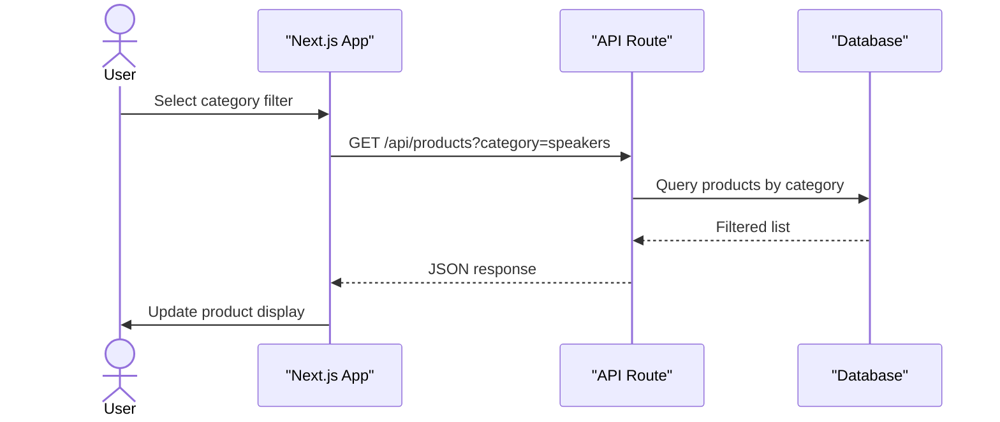
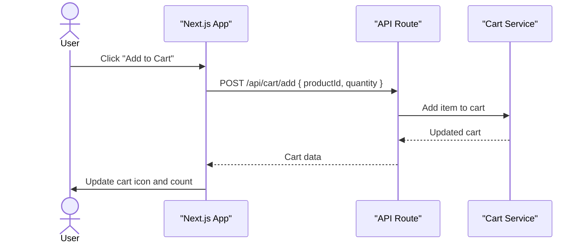

# Audiophile Ecommerce

A modern e-commerce platform tailored for audiophiles. Browse and purchase premium headphones, speakers, and audio equipment with a fast, fluid shopping experience. Built to be responsive, accessible, and easy to extend.

## System Architecture


The client communicates with the Next.js server, which handles rendering, API routes, and database interactions. The architecture supports server-side rendering for SEO and performance, with static generation where possible.

## Features

### Product Discovery

Visitors can explore a curated catalog of audio gear. Filter products by category, brand, or price range and get instant updates without page reloads.



### Shopping Cart

Add items to a persistent cart with real-time quantity adjustments and a summary before checkout.



### Responsive & Accessible

Every page adapts seamlessly to any screen size. Dark mode support is built in, and the interface follows accessibility best practices.

### Performant

Server‑side rendering and static generation ensure quick page loads. Images are optimized, fonts are automatically optimized by Next.js, and code is split for minimal bundles.

## Installation

1.  Clone the repository:

    ```bash
    git clone https://github.com/Ridwan-Lawal/audiophile-ecommerce.git
    ```

2.  Move into the project directory:

    ```bash
    cd audiophile-ecommerce
    ```

3.  Install dependencies (use npm, yarn, pnpm, or bun):

    ```bash
    npm install
    ```

4.  Start the development server with Turbopack:

    ```bash
    npm run dev
    ```

    The app will be running at `http://localhost:3000`.

## Usage

- Edit `src/app/page.tsx` to customise the home page. Changes are reflected in the browser immediately.
- Add new pages by creating folders and `page.tsx` files under `src/app`. The file‑based routing in Next.js makes this straightforward.
- Use the built‑in CSS (Tailwind) classes to style components; the configuration lives in `postcss.config.mjs` and `src/app/globals.css`.
- For production, build the app with:

  ```bash
  npm run build
  ```

  and run it with:

  ```bash
  npm start
  ```

## Technologies Used

| Technology                                    | Purpose                                                               |
| --------------------------------------------- | --------------------------------------------------------------------- |
| [Next.js](https://nextjs.org/)                | React framework for server‑side rendering, routing, and optimisations |
| [React](https://react.dev/)                   | UI library                                                            |
| [TypeScript](https://www.typescriptlang.org/) | Static type checking                                                  |
| [Tailwind CSS](https://tailwindcss.com/)      | Utility‑first CSS framework                                           |
| [ESLint](https://eslint.org/)                 | Linting (Next.js core‑web‑vitals and TypeScript rules)                |
| [Geist Font](https://vercel.com/font)         | Optimised font family by Vercel                                       |

## Author

- **Ridwan Lawal**
  - [LinkedIn](https://linkedin.com/in/ridwan-lawal-dev)
  - [X (Twitter)](https://x.com/lawal_dev_)

## Badges

[](https://nextjs.org/)
[](https://react.dev/)
[](https://www.typescriptlang.org/)
[](https://tailwindcss.com/)
